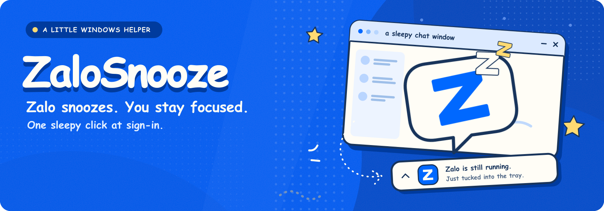

# ZaloSnooze

[Tiếng Việt](README.md) · [Downloads](https://github.com/chu0n/ZaloSnooze/releases) · [Report an issue](https://github.com/chu0n/ZaloSnooze/issues)

ZaloSnooze starts Zalo at Windows sign-in, sends its window to the tray or minimizes it to the taskbar, then exits. It supports Windows 10 and 11 and needs no extra runtime.

## Install

- **Setup:** Run the ZaloSnooze `Setup.exe` from the downloads page. Setup installs for the current account by default.
- **Portable:** Extract the entire `Portable-x86.zip` package to a writable folder, then open `ZaloSnooze.exe`. Do not run it from inside the ZIP.

If no download is available yet, follow the [build guide](docs/DEVELOPMENT.md). The packages are currently unsigned.

## Use

1. Open ZaloSnooze and select **Enable automatic startup**. If prompted, choose whether ZaloSnooze should take over Zalo’s existing startup entries.
2. If you want Zalo to stay on the taskbar, select the minimize option under the main button. Otherwise, ZaloSnooze sends it to the tray.
3. Close Settings. If Windows has no Internet access at sign-in, ZaloSnooze waits until Windows reports a connection before starting Zalo.

Disable automatic startup in ZaloSnooze to restore the entries it changed, unless they conflict with newer changes. For an all-user install, each user should do this before uninstalling.

**Help → Check for updates** opens the project’s GitHub Releases page. ZaloSnooze does not check, download, or install updates in the background.

## Limits

Zalo’s window may flash before the helper can act. ZaloSnooze does not modify Zalo files, inject code, or keep running after its one-time startup check.

[Troubleshooting](docs/DEBUGGING.md) · [Architecture](docs/ARCHITECTURE.md) · [MIT License](LICENSE)
